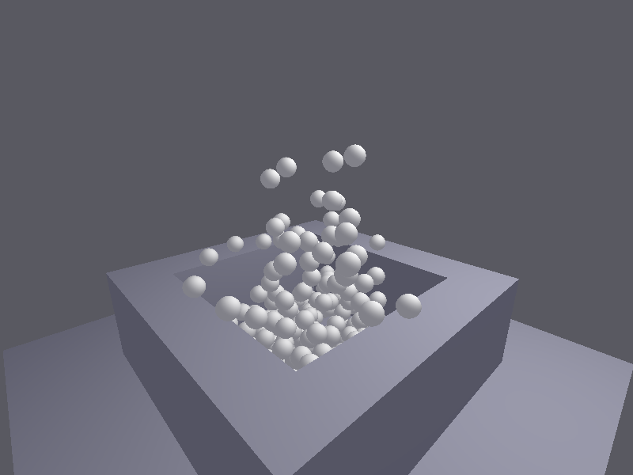
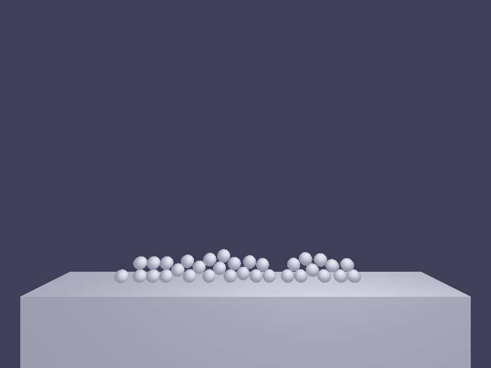
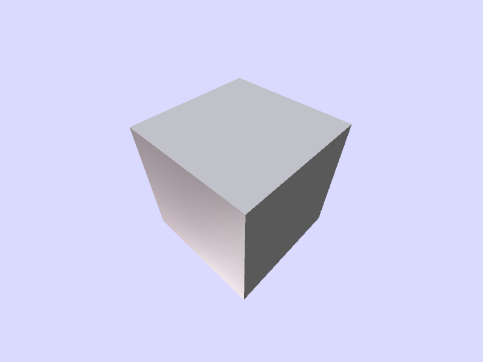
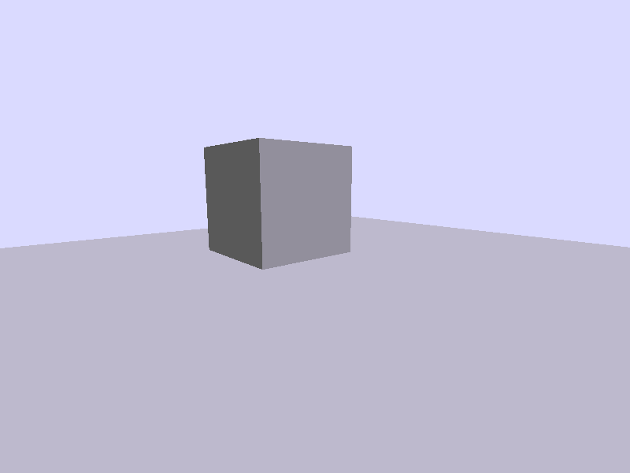
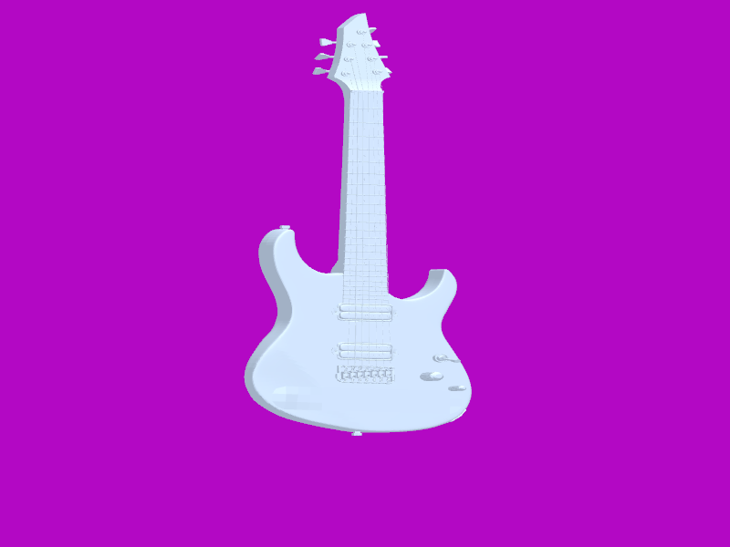
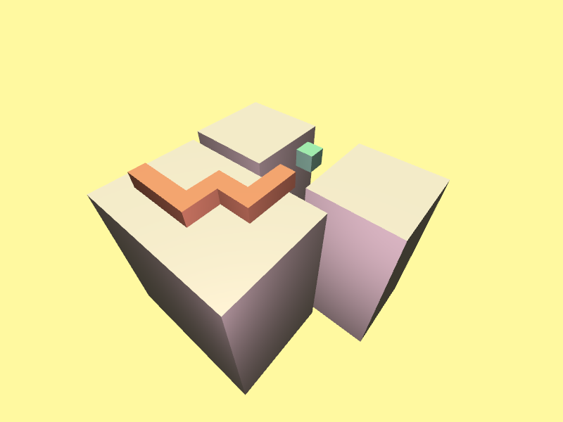

# The PI Engine

PI Engine is a (simplified) physics engine learning project solely developped by bbeltza! It runs on SDL3, supports AABB and sphere collisions (Convex shape collisions not...), and supports rendering with Direct3D 10 and Core 3.3 OpenGL! It is almost a fully fledged engine!

There isn't much on how to use the engine, **you cannot integrate it into your project unless you sticked to its API,** which itself is very limited. Sorry for that, I did not want to make a full integrable library with this, although there exists a single C header math (and a small C++ wrapper helper) library that, although still it is single header, only requires to include a few headers, and can entirely be integrated into your project!

You can find the examples inside "examples/", a few screenshots and steps on how to build and run them are below.

## Examples (Screenshots)

 





## Building

### Requirements

- Windows and Linux are both supported.
- Git, you'll need it to clone this repository.
- A compiler, MSVC and GCC were tested for Windows and Linux respectively.
- CMake (version 3.12 at least), and a build system like Ninja or Make.

> If you're on linux, you might need to install some more packages that SDL depends on (or, install SDL3's development libraries, something like `libSDL3-dev`)

> On Windows, you very likely want the Windows SDK installed, it should come with Visual Studio when you try to install MSVC.

### Downloading

To get this repository, clone it:
```sh
git clone https://github.com/bbeltza/PI-Engine.git --recursive
```
> Please, use the `--recursive` flag to clone this repository, otherwise, SDL won't be included and thus building will fail! If you accidentally didn't clone with the flag, you don't need to re-clone the entire repository, just type this inside the repo:
> ```sh
> git submodule update --init --recursive
> ```

The engine's source code should now be downloaded with SDL3 included!

### Compiling

To compile, you would simply do:

```sh
cmake -B build
```

Inside the repository, this will create a configured output folder inside "build". If you want to use more or different options, you should know how to use them first, but they should mostly work.
To compile the examples, just type:

```sh
cmake --build build
```

or inside the build directoy:

```sh
ninja
```
or
```sh
make -j4 # This "4" depends on the number of threads that you want to use, and the number of threads that you have in your system. Using `make` without anything is really slow.
```

depending on the build system that you choose. If you don't know, just use the command above those.

All of the build examples will be inside build/examples. You'll be able to run them.
